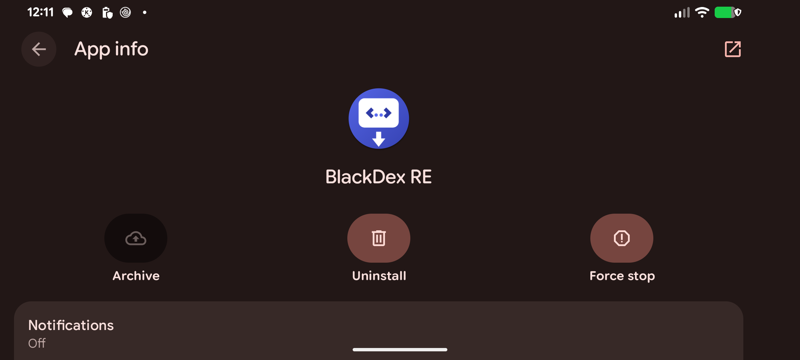
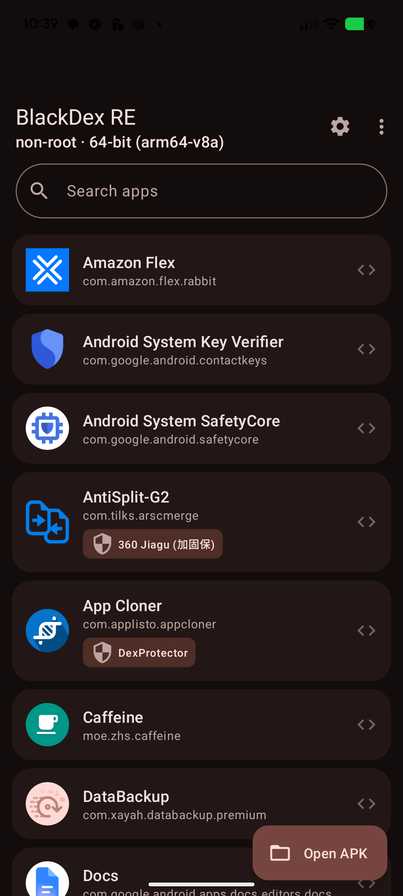
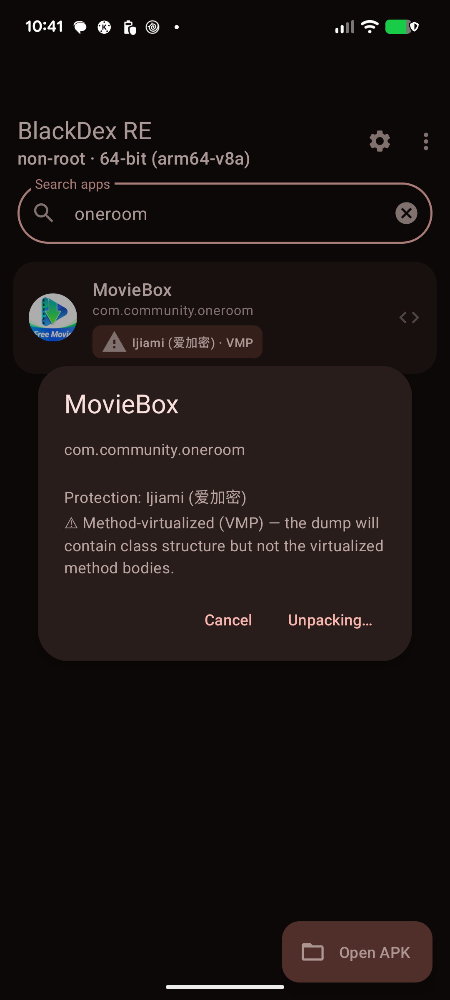
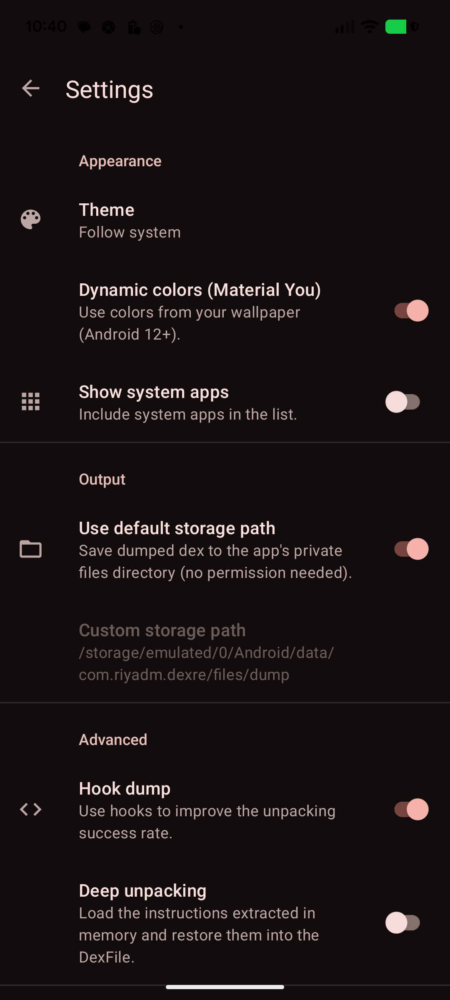

<div align="center">

# BlackDex RE

**Non-root DEX unpacker / dumper for modern Android — rebuilt for Android 13–17.**

Extract the real `.dex` files from installed apps or APK files, directly from ART memory,
with **no root, no Xposed, no PC, no adb**. Just install and tap.



[-3DDC84?logo=android&logoColor=white)](#)
[-blue)](#)
[](#license)

</div>

---

## This is a fork

**BlackDex RE** is **[riyadm](https://github.com/riyadmondol2006)'s fork** of the original
[CodingGay/BlackDex](https://github.com/CodingGay/BlackDex) (Apache-2.0). The upstream project
officially supported only Android 5.0–12 and shipped as two separate apps (32-bit and 64-bit).

This fork brings it to **modern Android (tested end-to-end on Android 17 / API 37, Pixel 6)**,
merges both architectures into one universal APK, rebuilds the UI in Material 3, and adds a set of
reverse-engineering quality-of-life features.

> ⭐ Fork home: **https://github.com/riyadmondol2006/BlackDex-RE**

---

## Screenshots

| App list + protection badges | Packer / VMP detection | Settings (Material You) |
|---|---|---|
|  |  |  |

---

## What was broken on new Android — and fixed in RE

The upstream framework (a VirtualApp-style in-process sandbox) broke in many places after
Android 12. Every one of these was diagnosed on-device and fixed:

| Problem on Android 13–17 | Fix in RE |
|---|---|
| Hidden-API reflection blocked; FreeReflection's `setHiddenApiExemptions` is `blocked` on API 34+ | Switched to **LSPosed HiddenApiBypass** (+ FreeReflection fallback) |
| `LoadedApk.makeApplication(boolean,Instrumentation)` removed on API 34+ | Fall back to **`makeApplicationInner`** |
| PackageManager hooks cast flags to `int`, but flags became **`long`** on API 33+ | Safe `Number`→`int` coercion across all service hooks |
| `ClientTransaction.mActivityCallbacks` replaced by **`mTransactionItems`** on API 34 | Read whichever field exists |
| API 34+ refuses to load a **writable dex** (`SecurityException: Writable dex file … is not allowed`) | Mark injected apk/jar/dex **read-only** after copying |
| The `:black` server process got **frozen/killed** by the Cached-Apps Freezer mid-dump | Proper persistent **foreground service** + a dump path that keeps the process boosted |
| Activity-launch config-change **NPE** / proxy-process teardown race | Dump via a **direct bind** over the process binder — no stub Activity |
| Native dumper read **ART `DexFile` C++ offsets** that change every release → crash / 0-byte dumps | Rewrote it to **locate the dex by magic scan** and read size from the **dex header**; **16 KB-page safe** |
| `art::ClassLinker::LoadMethod` symbol gone / inlined on API 36+ | Cookie-based dump that doesn't depend on that symbol |
| Old toolchain (AGP 4.2 / Gradle 6.7) wouldn't build on modern JDKs | **AGP 8.7, Gradle 8.12, Kotlin 1.9, JDK 17, NDK r27, compileSdk 36** |

---

## New features

- 🧱 **Single universal APK** — ships `arm64-v8a` + `armeabi-v7a`. No more two separate apps; the
  install automatically runs guest apps in the device's native bitness, with a clear message when an
  app needs the other architecture.
- 🎨 **Material 3 UI remake** — dynamic **Material You** color, light/dark/system **theme picker**,
  live search, edge-to-edge, an SAF **"Open APK"** picker (no storage permission), new launcher icon.
- 🛡️ **Packer / protection detection** — identifies the packer an app uses right in the list and
  before dumping: **Ijiami, 360 Jiagu, Tencent Legu, Bangcle/SecNeo, Baidu, Alibaba, NetEase,
  DexProtector, pairip**, and more — with a **VMP warning** when method virtualization means a dump
  can't be complete.
- 📤 **Share / export dumps** — zip the dumped dex (renamed `classes.dex`, `classes2.dex`, … so
  tools like jadx open them directly) and share, or open the output folder.
- 🧩 **Packer-aware dumping** — anti-self-kill hardening (seccomp + inline libc/ptrace hooks) lets
  many packers run far enough to decrypt, the target's `Application.onCreate` is driven so init-time
  packers materialise their code, and stub/host-dex filtering keeps the output to **only the target
  app's** `.dex` (renamed `classes.dex`, `classes2.dex`, … in the export zip).
- ⚙️ **More settings** — show system apps, choose output path, hook-dump / deep-unpack toggles.

---

## What it can (and can't) dump

| Target | Result |
|---|---|
| **Normal / unprotected apps** | ✅ **Full dump** — verified on Android 17: Open Camera (7 MB, 5336 classes), LocalSend (Flutter), Caffeine |
| **Packed apps** (360 Jiagu, Bangcle, Tencent, …) | ⚠️ **Partial** — captures everything reachable from the app's classloader chain. Some packers decrypt the real dex into a private/isolated classloader and will yield only the shell; fully following those needs a native class-load hook (planned). |
| **VMP / Dex2C** — e.g. **Ijiami DexVMP** (MovieBox) | ❌ **Class structure only.** The real method bodies run on the packer's own native VM and are **not standard DEX bytecode**, so **no DEX dumper (root or not) can recover them** — that needs VMP devirtualization. RE flags these apps up-front with a **VMP** badge. |

> The protection badges mean you always know *before* dumping what you'll get out of an app.

---

## Build

Requirements: JDK 17 (or 21), Android SDK with **NDK `27.0.12077973`** and **CMake `3.22.1`**.

```bash
echo "sdk.dir=$ANDROID_HOME" > local.properties
./gradlew :app:assembleDebug
# → app/build/outputs/apk/debug/app-debug.apk  (universal: arm64 + arm32)
```

## Usage

1. Install and open **BlackDex RE**.
2. Pick an installed app, or tap **Open APK** to choose an `.apk`. A protection badge tells you if
   it's packed.
3. Confirm. The app is launched in the sandbox and its DEX is snapshotted from memory.
4. On success, **Share** the zipped dex or **Open folder**. Default output:
   `/sdcard/Android/data/com.riyadm.dexre/files/dump/<package>/`

**Settings** — theme & dynamic color, show system apps, output path, *Hook dump* (ART hooks for
better success on packers), *Deep unpacking* (restore in-memory code items; slower).

---

## Architecture note (32-bit vs 64-bit)

A process runs native code of exactly one bitness. From one install:

- On a **64-bit device**: dumps 64-bit apps and pure-Java apps of any architecture.
- On a **32-bit device**: dumps 32-bit apps and pure-Java apps.

A 32-bit-**only** app that needs its native code at startup can't run inside a 64-bit host (and
vice-versa) — a platform limitation, not a bug. RE detects this and tells you instead of failing
silently, and only lists apps the current install can actually dump.

---

## How it works

BlackDex installs the target into a private sandbox, spins up a pre-declared proxy process,
hijacks `ActivityThread` via reflection to build the target's `Application` inside that process,
then a native library (`libblackdex.so`) walks the ART `DexFile` cookies and copies each DEX image
out of memory. A packer that decrypts its real DEX at runtime therefore ends up writing that
decrypted DEX to disk.

## Credits

Original [BlackDex](https://github.com/CodingGay/BlackDex) by CodingGay ·
[VirtualApp](https://github.com/asLody/VirtualApp) ·
[VirtualAPK](https://github.com/didi/VirtualAPK) ·
[FreeReflection](https://github.com/tiann/FreeReflection) ·
[AndroidHiddenApiBypass](https://github.com/LSPosed/AndroidHiddenApiBypass) ·
[Dobby](https://github.com/jmpews/Dobby) ·
[xHook](https://github.com/iqiyi/xHook) ·
[lkchandexfile](https://github.com/lkchan724/lkchandexfile)

## License

Apache-2.0, inherited from upstream. For security research and analysis of software you are
authorised to analyse.
